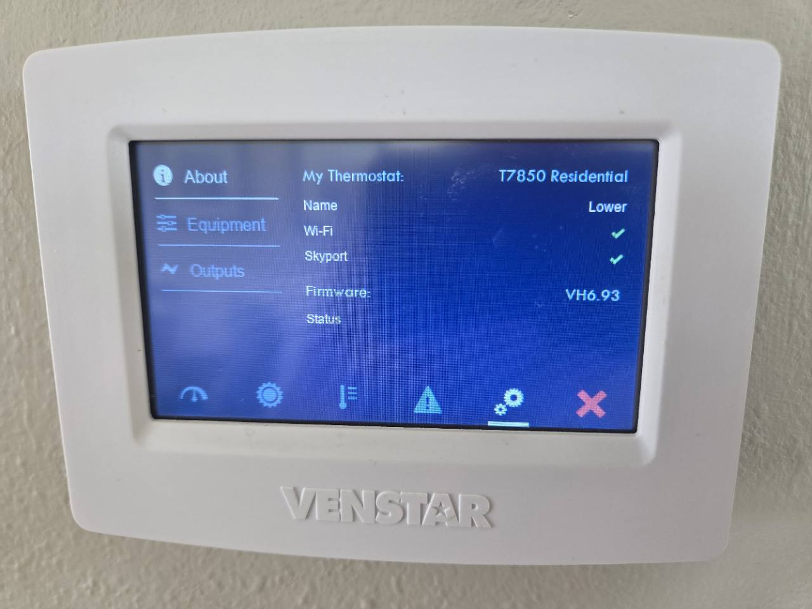

# localstar-openport Home Assistant add-on

Run a local Skyport weather and time server for Venstar ColorTouch thermostats
as a Home Assistant Supervisor add-on/app. Keep the existing HA Venstar integration for HVAC controls and entities.

Home Assistant's **Running** label on the add-on page reports whether this
container is running. Thr local Skyport server itself may still be stopped while certificate setup is pending or if it needs attention. Open the **Web UI** for the live Skyport status. for setup you generate certificates and an sd card image that you write to an sd card which is used to allow your thermostat to communicate with your local skyport server.

## Install

[Add this repository to Home Assistant](https://my.home-assistant.io/redirect/supervisor_add_addon_repository/?repository_url=https%3A%2F%2Fgithub.com%2Fkevincw01%2Flocalstar-openport-addon)

1. Open **Settings > Add-ons > Add-on Store > ⋮ > Repositories** (or the Apps store
   on versions using that name).
2. Add `https://github.com/kevincw01/localstar-openport-addon`.
3. Install **localstar-openport**. The container builds locally on your HA host.
4. Start the add-on; initial latitude, longitude, and timezone come from Home
   Assistant.  Optional
   coordinates and the timezone dropdown let you edit those settings.
   Enable **Start on boot** and **Watchdog**.
5. Certificate path fields start empty. goto the web UI to perform setup.  Choose **Generate certificate and key**, then
   create an SD-card image for thermostat provisioning. To migrate an server or use your certs and keys, choose
   **Upload and activate** with its existing certificate chain, matching key,
   and public root CA.
6. On your firewall or router, configure DNS to route `connect.skyport.io` to the IP address of your home assistant server.  if necessary allow your thermostats access to TCP ports **9001** and **41414**.  Thermostats no longer need access to the internet.

One installation serves multiple thermostats. Supports **aarch64** and **amd64**.
The web UI offers two certificate workflows for setup:

- **Generate:** create a CA and matching server certificate,
  then create a thermostat SD-card image containing the public root.
- **Upload:** validate and retain an existing certificate/key pair for the server. Upload a matching public root CA which is used by the thermostat for skyport connection trust.

All three files are stored in persistent add-on data. Successful generation/upload
fills the certificate, key, and root CA path fields in HA Configuration before
starting Skyport. Generate/upload actions replace an existing saved identity if one exists.
The SD-card image builder asks for the firmware version shown on the thermostat's
About screen; it uses this to ensure the thermostat validates the sd card. If you dont use the correct version number, the thermostat may not allow you to import the new root CA.



Enter the value shown beside **Firmware**, including the `VH` prefix.

After downloading the SD-card image from the add-on Web UI, write the `.img` file
to an SD card with Rufus or another disk-image writer. Choose **DD Image mode**
if Rufus prompts you; writing the image erases the selected card. Then:

1. Eject the card, insert it into the thermostat, and open **SD Card →
   Import/Export**.
2. Choose **Custom Images** only and complete the import. If the thermostat
   prompts you to update firmware, cancel the prompt. The image imports the
   public root CA; it does not install firmware. Importing images clears custom
   wallpapers.
3. Remove the card and restart the thermostat so it reloads the root CA.

## Home Assistant entities

With HA's **MQTT integration** configured and an MQTT broker available, the add-on
automatically discovers weather sensors and Skyport diagnostics. A Supervisor
broker such as Mosquitto is detected automatically; an external broker can be
configured with the optional `mqtt_*` settings. MQTT is optional for Skyport.

- Weather: outdoor temperature, humidity, wind speed/direction, condition,
  today's high/low, and precipitation probability, all from the existing cache.
- Server: running status, detected/connected thermostat counts, weather last
  update/cache age/fetch problem, and server certificate expiry.
- Each detected thermostat: Skyport connection, last seen, last successful ping
  echo, and last weather response; its address and firmware appear as attributes.

Thermostats are discovered when they log in to this server. HA can rename the
resulting devices to match your rooms. This reports the Skyport connection;
the existing Venstar integration still supplies thermostat controls and indoor
measurements. Weather values do not prove that a thermostat rendered its screen.

## Development and tests

```sh
python3 -m pip install -r requirements-dev.txt
python3 -m unittest discover -s tests -v
docker build -t localstar-openport:test .
python3 tests/smoke_addon.py
python3 tests/smoke_certificates.py
python3 tests/smoke_mqtt.py
python3 tests/smoke_location.py
```

The unit/TLS tests use disposable keys, synthetic weather, and local sockets.
The Docker smoke test uses temporary credentials, loopback-only host ports,
and live Open-Meteo data; `--skip-weather` skips provider access.
Use `--sudo` if your Docker daemon requires it. These tests can be run locally;
GitHub Actions test workflows are not configured. The add-on supports ARM64 and amd64.
The provisioning smoke test uses an isolated Docker network to verify the
Supervisor-only ingress gate, generation, upload, persistence, and child recovery.
The MQTT smoke test starts a disposable loopback-only Mosquitto container and
drives real TLS clients with synthetic weather through MQTT discovery/state.
The location smoke test uses a disposable Core API proxy to check inheritance,
static settings, explicit timezone changes, and recovery without touching an HA installation.
Refresh the published timezone choices with `python3 tools/update_timezones.py`
after updating the development environment's IANA data.
